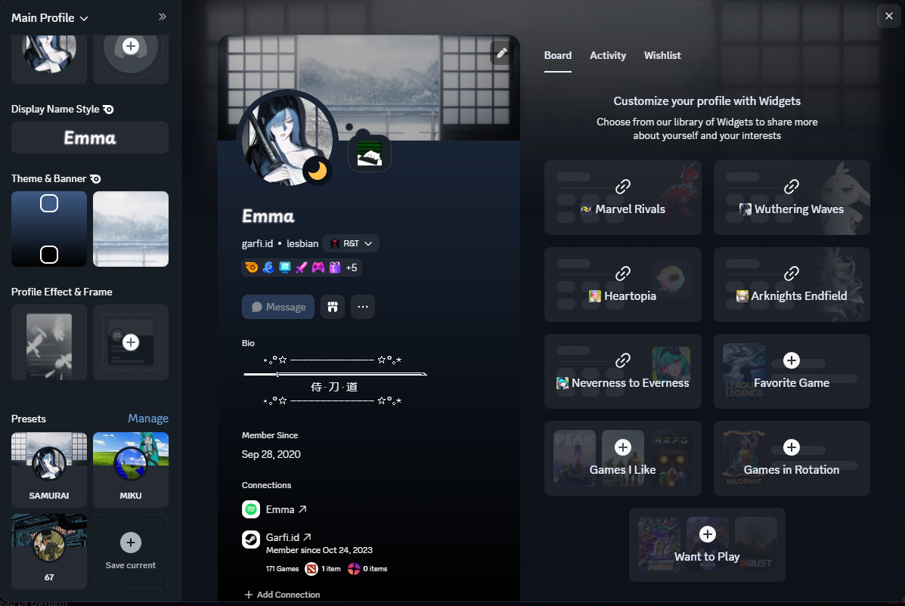
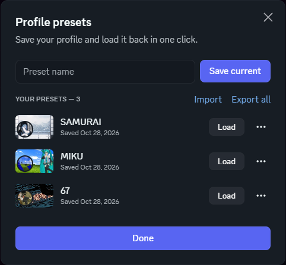

# Profile Presets

A Vencord plugin that saves your whole Discord profile as presets, so you can switch between looks in one click.

It adds a **Presets** section to the profile editor, right under *Profile Effect & Frame*. Save the look you have, then come back to it whenever you want.

<p align="center">
  
  &nbsp;&nbsp;
  
</p>

## What's saved

- Avatar and banner, including animated ones
- Bio
- Profile colors
- Avatar decoration, profile effect, nameplate and frame
- Board widgets

## How switching works

Click a preset and it fills the profile editor. You check the preview, then click Discord's **Save**.

The plugin never pushes your profile to Discord by itself. Discord sends one save request, exactly like when you edit your profile by hand. Most preset plugins fire a burst of requests instead, one per field, which gets you "you're changing this too fast" and captcha after captcha. This one doesn't.

Two more things keep it light:
- **Images:** your avatar and banner are only loaded when they differ from the ones you already have.
- **Widgets:** your Board is restored only when it differs, through Discord's own widget save. A preset never clears your Board.

## Install

This is a userplugin, so you build Vencord from source. You need [Git](https://git-scm.com), [Node.js](https://nodejs.org) (LTS) and pnpm (`npm i -g pnpm`).

```sh
git clone https://github.com/Vendicated/Vencord
cd Vencord
pnpm install --frozen-lockfile
git clone https://github.com/garfiid/vencord-profile-presets src/userplugins/profilePresets
pnpm build
```

Then load your build:

- **Discord:** fully quit Discord, then run `pnpm inject`.
- **Vesktop:** go to Settings → Vesktop → Open Developer Settings → Vencord Location, pick the `Vencord/dist` folder, then fully quit and restart Vesktop.

Finally, enable **ProfilePresets** in Settings → Vencord → Plugins.

On Windows, if PowerShell won't run `npm` or `pnpm`, run `Set-ExecutionPolicy -Scope CurrentUser RemoteSigned` once.

To update the plugin later: run `git pull` in `src/userplugins/profilePresets`, then `pnpm build` in the Vencord folder.

## Usage

1. **Save a look:** open Edit Profile, set it up, then click **Save current** in the Presets section and give it a name. Changes you haven't saved in the editor yet are included.
2. **Switch:** click a preset, check the preview, click Discord's **Save**.
3. **Manage presets:** right-click a preset, or click **Manage**, to load, rename, update with your current profile, export or delete it.

The presets window is also available from the chat bar button and the Vencord toolbox. Import and export use plain JSON files.

## Settings

| Setting | Default | What it's for |
|---|---|---|
| First section title | `Nameplate` | The plugin finds the editor sidebar by its section titles. If your Discord isn't in English, set these to the titles you see. |
| Last section title | `Profile Effect & Frame` | Presets is added after this section. |

## Limitations

- **Profile effects:** Discord only gives the full data of an effect (its animation) when you equip it in the editor. The plugin remembers every item you equip. If a preset has an effect you haven't equipped since installing the plugin, equip it once by hand.
- **Not included:** display name, pronouns, custom status and server profiles.
- **Discord updates:** Discord changes its internals regularly. If something breaks after an update, open an issue.

## Privacy and security

- **Local storage:** presets stay on your computer, in Vencord's storage.
- **Network:** the plugin only talks to Discord's own API and CDN, and never reads your token.
- **Imports:** imported files are validated before use. Images must be real images, item IDs must be numeric, and any link inside a preset has to point to Discord's CDN.

Still, only import presets from people you trust.

## Upgrading from an older version

Presets saved with earlier versions of this plugin are converted automatically the first time it starts.

## Disclaimer

Client mods are against Discord's Terms of Service. Use at your own risk.

## License

[GPL-3.0-or-later](LICENSE), like Vencord.
